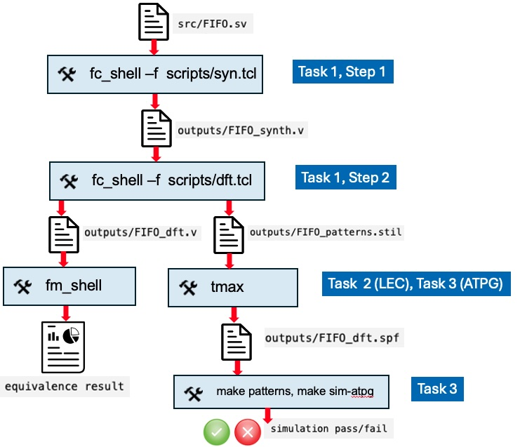
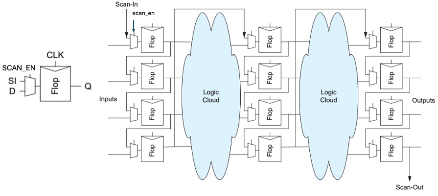

##### Imperial College London, Department of Electrical & Electronic Engineering

#### ELEC70142 Digital VLSI Design

### Lab 4 – Scan Chain Insertion, ATPG and Logic Equivalence Check

##### *Peter Cheung, v3.0 – 19 November 2026*

---

#### Objectives

By the end of this lab, you will be able to:

1. Insert a multiplexed-flip-flop scan chain into a synthesised netlist and interpret the DFT design rule check (DRC).
2. Quantify the area and timing cost of scan insertion.
3. Prove that the scan-inserted netlist is equivalent to the RTL, and explain why test    signals must be constrained for the proof to hold.
4. Generate stuck-at test patterns with an ATPG tool and explain the coverage figures it    reports.
5. Validate the patterns by simulating them against the scan netlist.

>Note: There are test-yourself questions in this Lab.  Discuss with your teammates about the answers. If stuck, ask one of the GTAs.
---

#### Before You Start

##### Environment

The scripts depend on two environment variables from the course kit:

| Variable          | Used by                          | What it points to                           |
|-------------------|----------------------------------|---------------------------------------------|
| `SYN_KIT_TCL`     | every Tcl script, via `setup.tcl` | the PDK set-up script (libraries, tech file) |
| `SYN_SIM_MODELS`  | `make patterns`, `make sim-atpg`  | the standard-cell Verilog simulation models  |

Load the kit as you did in Lab 1, then check that both are set:

```bash
echo $SYN_KIT_TCL
echo $SYN_SIM_MODELS
```

`make patterns` also needs `stil2verilog` on your `PATH`. On the teaching server this is a wrapper around the Synopsys binary. Check it with `which stil2verilog`.

#### The Tool Flow

Below shows the tool flow for this lab and the files being produced.

<div align="center">
    
</div>

Reports go to `reports/`, logs to `logs/`, and netlists and other hand-offs to `outputs/`. `make clean` removes all of them. 

---

#### Background: Scan Design for Test

A circuit with a sequential state is hard to test. To test a fault deep inside, you must first drive the circuit into the right state through its primary inputs, which can take many cycles. Then the fault's effect must travel to an output, which can take many more.

**Scan design** removes this problem. Every flip-flop is replaced by a *scan flip-flop*: an ordinary D flip-flop with a 2:1 multiplexer in front of it.

<div align="center">
    
</div>

With `scan_en = 1`, the flops are joined into one long **shift register** (the *scan chain*), running from a new input port `scan_di` to a new output port `scan_do`. A test then has three phases:

1. **Shift in** (`scan_en = 1`): clock a chosen state serially into every flop.
2. **Capture** (`scan_en = 0`): apply primary inputs and pulse the clock once, so every   flop captures the response of the combinational logic.
3. **Shift out** (`scan_en = 1`): clock the captured state out through `scan_do` and    compare it with the expected values. The next test is shifted in at the same time.

This turns testing a sequential circuit into testing **combinational logic** between directly controllable and observable points, which an ATPG tool can do automatically.

The fault model used here is **stuck-at**: each net may be permanently stuck at 0 or at 1. A pattern *detects* a fault if the faulty circuit's response differs from the good circuit's response.

For more details, see notes on Lectures 8 and 9.

---

#### Task 1 – Scan Chain Insertion

Fusion Compiler contains the TestMAX DFT engine, so scan insertion happens in the same tool you used for synthesis in Lab 1.

DFT can be applied during synthesis or added to a synthesised netlist. This lab does the second, so the cost of scan can be measured as a clean before-and-after comparison.

##### Step 1 – Synthesise the Design

The design is a synchronous FIFO, 16 words of 32 bits, with a ready/valid interface. Read `src/FIFO.sv` before you start.

```bash
fc_shell -f scripts/syn.tcl
```

Two things in the log are expected:

- `check_design` reports an **unloaded port `clk_en`**. The port is declared in the RTL   and never used. It has been left as it was.
- **Clock gating is suppressed** (`set_clock_gating_options -minimum_bitwidth` in   `scripts/syn.tcl`). A gated clock only toggles when its enable is active. During scan   shift, every flop must see a clock edge on every cycle, so gated flops would break   the chain. With no clock gates, every flop is clocked directly from `clk`.

> **Q1.** Count the flip-flops the RTL implies: the memory array, `wr_ptr`, `rd_ptr` and `count`. How many flops should the scan chain contain?

##### Step 2 – Insert Scan Chains

```bash
fc_shell -f scripts/dft.tcl
```

The script reads the synthesised netlist into a fresh library and adds scan to it. **The rest of this step explains what the script does, in order.** Read it alongside `scripts/dft.tcl`. The script takes port names and settings from variables in `scripts/setup.tcl`. The values are written out literally below.

**Configure scan and create the test ports.** One chain of multiplexed flip-flops, and four new ports:

- `scan_en`: selects the scan input at every flop (the `SI` leg of the mux above).
- `scan_testmode`: forces the design into a testable state, for example by holding   asynchronous resets or tristate enables. This design resets synchronously, has an   ungated clock and no tristates, so there is nothing to force, and the port stays   **unconnected**.
- `scan_di` and `scan_do`: the serial input and output of the chain.

```tcl
set_dft_configuration -scan enable
set_scan_configuration -style multiplexed_flip_flop -chain_count 1

create_port scan_en       -direction in
create_port scan_testmode -direction in
create_port scan_di       -direction in
create_port scan_do       -direction out

set_dft_signal -view spec -type ScanEnable  -port scan_en       -active_state 1
set_dft_signal -view spec -type TestMode    -port scan_testmode -active_state 1
set_dft_signal -view spec -type ScanDataIn  -port scan_di
set_dft_signal -view spec -type ScanDataOut -port scan_do
```

`-view spec` describes something for `insert_dft` to build. `-view existing_dft` describes something already in the design. The functional clock `clk` already exists, and it is declared as the scan clock:

```tcl
set_dft_signal -view existing_dft -type ScanClock -port clk -timing {45 55}
```

`-timing {45 55}` gives the rising and falling edge times of the test clock within a test cycle, in ns. The default test cycle is 100 ns, so the clock rises at 45 ns and falls at 55 ns. Inputs are applied early in the cycle and outputs are strobed before the clock edge. The test clock is slow on purpose: a tester shifts at a much lower frequency than the design's functional clock.

**Build the test protocol and check it.** `create_test_protocol` generates the shift-and-capture procedure. `dft_drc` checks that every flop can be controlled and observed through it. The script writes this check to `reports/dft_drc_pre.rpt`.

```tcl
create_test_protocol
dft_drc
```

**Preview, then insert.** `preview_dft` reports the chain it *would* build without changing the design (`reports/dft_preview.rpt`). `insert_dft` then builds it.

```tcl
preview_dft
insert_dft
```

**Constrain the new ports.** The new ports get the same input/output delays and drive as the functional ports, so the timing reports after insertion are a fair comparison.

**Re-check and export.** `dft_drc` runs again on the inserted chain (`reports/dft_drc_post.rpt`). The script then writes the scan netlist, the SDC, and the **STIL protocol file (SPF)**. The SPF tells the ATPG tool how to drive the chain, as used in Task 3.

```tcl
dft_drc
write_verilog outputs/FIFO_dft.v
write_sdc -output outputs/FIFO_dft.sdc
write_test_protocol -test_mode Internal_scan -output outputs/FIFO_dft.spf
```

> **Q2.** Open `reports/dft_preview.rpt`. How many cells does the chain contain? Does it match your answer to Q1? Which register is first in the chain, and which is last?
>
> **Q3.** Compare `reports/dft_drc_pre.rpt` with `reports/dft_drc_post.rpt`. What does each report say, and why might the two differ?

##### Step 3 – Inspect the Netlist and Measure the Cost of Scan

Open `outputs/FIFO_dft.v` and look at the module's port list, then search the body for the cells the flops have become.

> **Q4.** Which ports were added? Compare a flip-flop instance in `outputs/FIFO_synth.v` with the same register in `outputs/FIFO_dft.v`. What cell type replaced it, and which pins are new? Find a `scan_di`-to-`scan_do` connection path through the first two flops.
>
> **Q5.** `scan_testmode` exists in the port list but drives nothing. Why?

Now measure what scan cost. The synthesis run wrote `reports/synth_*.rpt` and the DFT run wrote `reports/dft_*.rpt`. Fill in this table from the area and QoR reports, for the `func_wc` scenario:

| Metric                         | After synthesis | After scan insertion | Change |
|--------------------------------|-----------------|----------------------|--------|
| Total cell area                |                 |                      |   %    |
| Sequential cell area           |                 |                      |   %    |
| Number of sequential cells     |                 |                      |        |
| Worst setup slack (ns)         |                 |                      |        |
| Total negative slack (ns)      |                 |                      |        |

`diff reports/synth_area.rpt reports/dft_area.rpt` can help you find the lines, but expect noise from dates and formatting.

> **Q6.** Where does the extra area come from? Why might worst setup slack get worse  after scan insertion? (Look at the D-pin path of a scan flop in `reports/dft_timing_max.rpt`.) Hold timing can also change: look at `reports/dft_timing_min.rpt`. What is special about the flop-to-flop paths that the scan chain adds?

---

#### Task 2 – Logic Equivalence Check (LEC)

Scan insertion edits the netlist, and synthesis already transformed it heavily. Logic Equivalence Check (LEC) proves *formally*, without simulation, that the final netlist  implements the same function as the RTL. It does this by pairing up **compare points** (registers and outputs) in the two designs and proving that the logic driving each pair is equivalent.

The Synopsys tool is called **Formality**:

```bash
fm_shell -f scripts/lec.tcl
```

The script compares `src/FIFO.sv` (the **reference**, `r:`) with `outputs/FIFO_dft.v` (the **implementation**, `i:`), which has been through both synthesis and scan insertion. Points to notice in `scripts/lec.tcl`:

- **SVF files.** `set_svf` loads the SVF files that Fusion Compiler wrote during   synthesis and DFT. They record the transformations the tool made, such as renamed or   merged registers, so Formality can match compare points it could not pair by name alone.
- **Test-mode constants.** The script ties the new test inputs inactive:

  ```tcl
  set_constant i:/WORK/FIFO/scan_en       0
  set_constant i:/WORK/FIFO/scan_testmode 0
  ```

  The scan netlist does **more** than the RTL: with `scan_en = 1` it becomes a shift   register. It is only equivalent to the RTL in functional mode. LEC therefore proves   equivalence *under the stated constraints*, not unconditionally.

A successful run ends with (error FM-006 occurs because the script tries to report errors - which in this case are not there):

```
********************************* Verification Results *********************************
Verification SUCCEEDED
----------------------
 Reference design: r:/WORK/FIFO
 Implementation design: i:/WORK/FIFO
 559 Passing compare points
----------------------------------------------------------------------------------------
Matched Compare Points     BBPin    Loop   BBNet     Cut    Port     DFF     LAT   TOTAL
----------------------------------------------------------------------------------------
Passing (equivalent)           0       0       0       0      34     525       0     559
Failing (not equivalent)       0       0       0       0       0       0       0       0
****************************************************************************************
```
> **Q7.** Account for the 525 DFF and 34 Port compare points. Which output ports make up the 34? `scan_do` is an output of the implementation. Why is it not among the compare points? (Look at `reports/lec_unmatched.rpt`.)

##### Exercise A – Break the netlist

1. Keep a copy of the good netlist: `cp outputs/FIFO_dft.v outputs/FIFO_dft.v.good`.
2. In `outputs/FIFO_dft.v`, make **one** small change to a gate on the `count` logic,    for example by changing a 2-input AND cell to the equivalent-sized OR cell from the    same library, or by exchanging an input net between two *different* gates. (Swapping the two inputs of one AND or OR gate changes nothing: the gate is symmetric.)
3. Re-run **only** the LEC: `fm_shell -f scripts/lec.tcl`.
   (Do not re-run `dft.tcl`, because it would overwrite your edit.)
4. Restore the good netlist: `cp outputs/FIFO_dft.v.good outputs/FIFO_dft.v`.

> **Q8.** Which compare points fail? Use `reports/lec_failing.rpt` and `reports/lec_analysis.rpt`. Why does one gate change cause several failing points?

##### Exercise B – Remove the test-mode constraint

1. Comment out the two `set_constant` lines in `scripts/lec.tcl` and re-run it. Look    at the result and at `reports/lec_constants.rpt`.
2. Also change `set_svf $SYNTH_SVF $DFT_SVF` to `set_svf $SYNTH_SVF`, so the DFT    guidance is not loaded, and re-run it again.
3. Restore both edits.

> **Q9.** What happened in each run, and why? In the first run, where did any constants come from? What does this tell you about what an equivalence check actually proves?

---

#### Task 3 – Automatic Test Pattern Generation (ATPG)

##### Step 1 – Generate Test Patterns

TestMAX ATPG reads the scan netlist and the protocol file written in Task 1:

```bash
tmax -shell -nostartup scripts/atpg.tcl
```

The script builds a model of the netlist, runs a DRC against the protocol, adds every stuck-at fault, and generates patterns. It writes:

- `outputs/FIFO_patterns.stil`: the patterns, in STIL tester format
- `outputs/FIFO_faults.rpt`: every fault and its final class

When the script finishes, it leaves you at a `TEST>` prompt with the fault list still loaded. Explore it:

```
TEST> report_summaries
TEST> report_faults -class AU
TEST> report_faults -class UD
TEST> exit
```

**TestMAX** sorts each fault into a class:

| Class | Meaning |
|-------|---------|
| DT    | Detected by a pattern |
| PT    | Possibly detected |
| UD    | Undetectable: no pattern can ever detect it (e.g. tied or unused logic) |
| AU    | ATPG untestable: not detectable under the current test constraints |
| ND    | Not detected: ATPG gave up or ran out of effort |

> **Q10.** From `report_summaries`, record the **number of patterns**, the **fault coverage** and the **test coverage**. Test coverage leaves undetectable faults out of the denominator. Why is it the more useful figure?
>
> **Q11.** Which faults are UD or AU? Relate at least one of them to the design. (Hint: what happens to the logic for `clk_en` and `scan_testmode`?)
>
> **Q12.** Each pattern needs the whole chain shifted. Estimate the number of test clock cycles for the full test set, using your chain length from Q2 and the pattern count from Q10.

##### Step 2 – Simulate the Patterns

A pattern set that the ATPG tool *believes* works has not yet been shown to work on the netlist. To check it, the patterns are turned into a Verilog testbench and simulated.

`write_patterns` in TestMAX writes tester formats only (STIL, WGL and so on). The supported route to Verilog is the *unified STIL flow*: write the patterns once as STIL, then translate them with `stil2verilog`:

```bash
make patterns
```

which runs:

```bash
stil2verilog outputs/FIFO_patterns.stil outputs/FIFO_patterns \
    -v_file outputs/FIFO_dft.v \
    -v_lib $SYN_SIM_MODELS \
    -serial -sim_script vcs
```

`-serial` makes the testbench shift every bit through the chain, one clock at a time, as a real tester does. 

The alternative, *parallel load*, writes values directly into the scan cells. It is faster, but it proves nothing about whether the chain is stitched correctly. A warning `W-006 no scan chains found` in `logs/stil2verilog.log is expected: it means a parallel-load testbench could not be built, and that one was not requested.

Then simulate:

```bash
make sim-atpg
```

The simulation log is `logs/sim_atpg.log`. At the end, the testbench prints a summary with the number of mismatches between simulated and expected responses. **A passing run reports zero.**

> **Q13.** Did all patterns pass? How long did the simulation take compared with the ATPG run, and why?

##### Optional – Watch the chain shift

The generated testbench does not dump waveforms. To add them, open `outputs/FIFO_patterns.v`, and inside the top-level module add:

```verilog
initial begin
    $dumpfile("sim/atpg.vcd");
    $dumpvars(0);
end
```

Then run `make sim-atpg` and `make waves` (GTKWave) or `make waves-verdi` (Verdi). Find `scan_en`, `scan_di` and `scan_do`, and identify the shift and capture phases.
(Running `make patterns` again regenerates the testbench and removes your edit.)

---

#### Extension – More Scan Chains

Set `CHAIN_COUNT` to 4 in `scripts/setup.tcl`, then re-run `dft.tcl` and `atpg.tcl`. Set  t back to 1 afterwards.

> **Q14.** How long is each chain now? How many extra ports were created? Repeat your Q12 estimate. What is the trade-off a chip designer faces in choosing the number of chains?

---

#### Reference – Working Interactively in Fusion Compiler

The scripts save their libraries, so you can reopen the scan design and query it:

```bash
fc_shell
```

```tcl
fc_shell> open_lib work/FIFO_dft.dlib
fc_shell> open_block FIFO
fc_shell> report_scan_path
fc_shell> dft_drc -coverage_estimate
```

`dft_drc -coverage_estimate` gives Fusion Compiler's quick estimate of test coverage. Compare it with the ATPG result from Q10.

For a more detailed DRC report, set this before running `dft_drc`:

```tcl
fc_shell> set_dft_drc_configuration -enhanced_dft_drc_report enable
```

#### Troubleshooting

| Symptom | Cause |
|---------|-------|
| `SYN_KIT_TCL is not set` | Load the course kit (see *Before You Start*). |
| `No netlist at outputs/FIFO_synth.v` | Run `scripts/syn.tcl` before `scripts/dft.tcl`. |
| `... clock gating cell(s) in outputs/FIFO_synth.v` | Clock gating slipped through synthesis. See the message, and re-run `syn.tcl`. |
| `... has no ScanStructures block` | The SPF describes no chains, so ATPG coverage would be near zero. Check `reports/dft_drc_post.rpt`. |
| LEC: `match paired up no compare points` | The netlist did not link against the library. Look for `FE-LINK` warnings. |
| `stil2verilog: command not found` | The wrapper is not on your `PATH`. |

